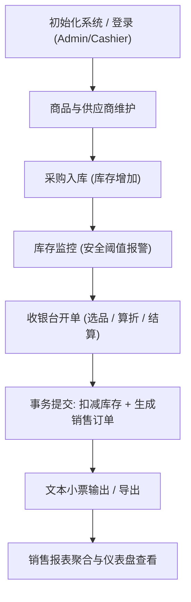

# 功能规格说明书 SPEC — pos-lite-modern

## 1. 概述与定位

`pos-lite-modern` 是对开源项目 [Point-of-Sales](https://github.com/sadatrafsanjani/Point-of-Sales)（原 JavaFX + Hibernate + MySQL 技术栈）进行思路提炼与现代轻量栈重写的新一代离线收银与库存管理系统（POS）。

本项目针对原项目在无图形环境（Linux 服务器/终端/嵌入式收银机）依赖重、需配置庞大 MySQL 数据库及复杂 JavaFX 运行时的痛点，采用 **Python 3 标准库 + SQLite3** 架构进行 100% 独立重构，实现**零外部依赖、秒级启动、全离线可用、数据轻量便携**，同时保留收银与库存的核心业务闭环，并大幅增强终端小票生成与销售统计分析报表能力。

---

## 2. 原项目功能参考与借鉴功能清单

基于原项目 README 与架构设计梳理出核心业务域：

| 模块 | 原项目参考点 | 本项目重构与实现规格 |
|---|---|---|
| **登录与权限 (Auth & Roles)** | 用户登录验证、管理与操作权限隔离 | 统一认证机制，支持管理员 (admin) 与收银员 (cashier) 角色分权，密码采用 PBKDF2/SHA-256 安全加盐哈希存储 |
| **商品与分类 (Product & Category)** | 商品 CRUD、分类归类管理 | 商品 SKU/条码支持、分类层级、进价/售价管理、当前库存与警戒线设置、停用/启用状态 |
| **供应商管理 (Supplier)** | 供应商信息录入与维护 | 供应商档案管理（名称、联系人、电话、邮箱、地址），支持关联采购入库流水 |
| **员工管理 (Employee)** | 员工与收银员资料及权限维护 | 员工账号生命周期管理，区分管理员和收银员，记录操作员工与收银经手人 |
| **采购入库 (Purchase/Restocking)** | 采购订单与库存补充 | 采购入库全流程，选择供应商与入库商品，自动增补对应商品库存并记录批次进货成本流水 |
| **收银开单 (POS Checkout)** | 选购商品、改数量、计价开单 | 交互式收银台，支持按 SKU/名称加购、动态数量修改、整单/单品折扣计算、应收实收与精准找零计算、自动原子扣减库存 |
| **发票与小票 (Receipt/Invoice)** | 原项目基于 iText 生成 PDF 发票 | 针对离线与无图形环境，增强生成标准 58mm/80mm 格式化纯文本热敏小票，支持终端即时输出、持久化存储与导出 |
| **库存追踪与报警 (Inventory Tracking)** | 实时库存统计与查看 | 实时库存看板、安全库存阈值报警（低库存高亮提示）、库存流水可审计 |
| **报表与仪表盘 (Report & Dashboard)** | 基础仪表盘与图表概览 | 增强销售日结报表、按商品/分类聚合销售统计、热销商品排行、客单价与毛利分析，支持 ASCII/表格化仪表盘与 Web 可视化仪表盘 |
| **数据持久化 (Storage)** | 外部 MySQL 数据库 | 嵌入式 SQLite3 数据库，本地自动初始化，单文件备份移植极为简便，完全支持离线脱网运行 |

---

## 3. 现代化改进与差异化要点

1. **极致轻量与零依赖 (Zero-dependency)**：采用 Python 3 标准库原生编写，不需要 `pip install` 任何第三方包，可在任何标准 Linux/macOS/Windows 环境即启即用。
2. **纯无头 (Headless) 运行与多端适配**：
   - 提供完备的 CLI 命令行接口，便于脚本自动化与纯终端操作。
   - 提供内置轻量 HTTP 本地服务（标准库 `http.server` 构建的 REST API + 单页响应式收银 Web UI），兼顾桌面/平板触控与终端使用。
3. **安全严谨的交易控制**：所有收银结算与采购入库操作均在 SQLite 事务（ACID）保护下执行，杜绝超卖、负库存（除非允许透支）或数据不一致。
4. **小票格式化与归档**：生成带流水号、开单时间、经手收银员、商品细目、优惠、找零、条形码占位符的标准热敏小票格式，并持久化到文本归档。
5. **开箱即用体验**：内置一键数据库初始化与演示数据种子（Demo Data），几秒钟内即可体验完整业务闭环。

---

## 4. 数据模型设计 (Database Schema)

采用轻量级 SQLite 关系型结构：

1. `users`：员工与账号表
   - `id` INTEGER PRIMARY KEY AUTOINCREMENT
   - `username` TEXT UNIQUE NOT NULL
   - `password_hash` TEXT NOT NULL
   - `salt` TEXT NOT NULL
   - `full_name` TEXT NOT NULL
   - `role` TEXT NOT NULL CHECK(role IN ('admin', 'cashier'))
   - `is_active` INTEGER DEFAULT 1
   - `created_at` TEXT NOT NULL

2. `categories`：商品分类表
   - `id` INTEGER PRIMARY KEY AUTOINCREMENT
   - `name` TEXT UNIQUE NOT NULL
   - `description` TEXT

3. `suppliers`：供应商表
   - `id` INTEGER PRIMARY KEY AUTOINCREMENT
   - `name` TEXT NOT NULL
   - `contact_person` TEXT
   - `phone` TEXT
   - `email` TEXT
   - `address` TEXT

4. `products`：商品表
   - `id` INTEGER PRIMARY KEY AUTOINCREMENT
   - `sku` TEXT UNIQUE NOT NULL
   - `barcode` TEXT
   - `name` TEXT NOT NULL
   - `category_id` INTEGER REFERENCES categories(id)
   - `supplier_id` INTEGER REFERENCES suppliers(id)
   - `cost_price` REAL NOT NULL DEFAULT 0.0
   - `sale_price` REAL NOT NULL DEFAULT 0.0
   - `stock_quantity` INTEGER NOT NULL DEFAULT 0
   - `min_stock_alert` INTEGER NOT NULL DEFAULT 10
   - `is_active` INTEGER DEFAULT 1
   - `created_at` TEXT NOT NULL

5. `purchases`：采购入库单
   - `id` INTEGER PRIMARY KEY AUTOINCREMENT
   - `purchase_no` TEXT UNIQUE NOT NULL
   - `supplier_id` INTEGER REFERENCES suppliers(id)
   - `total_cost` REAL NOT NULL
   - `notes` TEXT
   - `created_by` INTEGER REFERENCES users(id)
   - `created_at` TEXT NOT NULL

6. `purchase_items`：采购明细
   - `id` INTEGER PRIMARY KEY AUTOINCREMENT
   - `purchase_id` INTEGER REFERENCES purchases(id)
   - `product_id` INTEGER REFERENCES products(id)
   - `quantity` INTEGER NOT NULL
   - `unit_cost` REAL NOT NULL
   - `subtotal` REAL NOT NULL

7. `orders`：销售订单表
   - `id` INTEGER PRIMARY KEY AUTOINCREMENT
   - `invoice_no` TEXT UNIQUE NOT NULL
   - `cashier_id` INTEGER REFERENCES users(id)
   - `customer_name` TEXT DEFAULT 'Walk-in Customer'
   - `subtotal` REAL NOT NULL
   - `discount_amount` REAL NOT NULL DEFAULT 0.0
   - `tax_amount` REAL NOT NULL DEFAULT 0.0
   - `total_amount` REAL NOT NULL
   - `paid_amount` REAL NOT NULL
   - `change_amount` REAL NOT NULL
   - `payment_method` TEXT NOT NULL DEFAULT 'CASH'
   - `status` TEXT NOT NULL DEFAULT 'COMPLETED'
   - `receipt_text` TEXT
   - `created_at` TEXT NOT NULL

8. `order_items`：销售明细表
   - `id` INTEGER PRIMARY KEY AUTOINCREMENT
   - `order_id` INTEGER REFERENCES orders(id)
   - `product_id` INTEGER REFERENCES products(id)
   - `product_name` TEXT NOT NULL
   - `sku` TEXT NOT NULL
   - `unit_price` REAL NOT NULL
   - `quantity` INTEGER NOT NULL
   - `subtotal` REAL NOT NULL

---

## 5. 核心业务流程闭环



1. **商品建立与采购入库**：录入分类、供应商、商品信息；执行采购入库，商品库存原子增加，生成入库流水。
2. **收银台结算（核心闭环）**：
   - 录入订单明细（支持多件商品、多数量、折扣）。
   - 校验库存可用性（禁止负库存结账）。
   - 输入付款金额，自动核算找零。
   - 事务扣减库存，生成订单并打印纯文本热敏小票。
3. **小票归档**：保存小票为独立文本文件，支持收银员按单号查询与打印。
4. **统计报表与看板**：按日统计营收、客单量、商品销售分布；低库存警报清单即时可查。

---

## 6. 使用与命令设计

统一通过 `pos_app.py` 入口调用：
- `python3 pos_app.py init-db [--demo]`：初始化数据库及演示数据
- `python3 pos_app.py list-products`：列出商品及库存
- `python3 pos_app.py restock --product <SKU> --qty <QTY> --cost <COST>`：采购入库
- `python3 pos_app.py checkout --items '<SKU>:<QTY>,...' --paid <AMOUNT> [--discount <DISC>]`：开单收银与库存扣减
- `python3 pos_app.py receipt --invoice <INVOICE_NO>`：查看/打印小票
- `python3 pos_app.py report [--days 7]`：销售与库存报表看板
- `python3 pos_app.py serve [--port 8080]`：启动轻量本地 Web 收银端

---

## 7. 自测记录 (Self-Test Records)

自测环境：Linux 6.6.137+ / Python 3.12.3 / SQLite 3.45.1（无外网、纯无头 Linux 终端环境）
测试轮次：第 1 轮全量测试通过（无报错，流程一次性通过）

### 7.1 数据库初始化与演示数据注入
- **执行命令**：
  ```bash
  python3 pos_app.py init-db --demo
  ```
- **输出结果**：
  ```text
  [OK] Database initialized and seeded. (Demo data: Enabled)
  Default accounts:
    - Admin  : admin / <your-secret>
    - Cashier: cashier / <your-secret>
  ```

### 7.2 员工、分类与商品管理测试
- **执行命令**：
  ```bash
  python3 pos_app.py add-user --username bob --password bobpass --name "Bob Cashier" --role cashier
  python3 pos_app.py add-category --name "Desserts" --desc "Cakes and sweet treats"
  python3 pos_app.py add-product --sku SKU-DES-08 --name "Matcha Mousse Cake" --price 15.00 --cost 6.00 --qty 12 --alert 5 --category 4
  ```
- **输出结果**：
  ```text
  [OK] User created successfully: ID 3, bob (cashier)
  [OK] Category 'Desserts' created with ID 4
  [OK] Product created: [SKU-DES-08] Matcha Mousse Cake - Sale: $15.00, Stock: 12
  ```

### 7.3 采购入库测试 (Restock)
- **执行命令**：
  ```bash
  python3 pos_app.py restock --product SKU-MIL-03 --qty 20 --cost 9.50 --notes "Batch 2026-11 import"
  ```
- **输出结果**：
  ```text
  [OK] Restock Successful: PO-20261117025541-300
       Product   : Organic Oat Milk 1L (ID 3)
       Added Qty : +20
       New Stock : 28 units
       Total Cost: $190.00 (@ $9.50/ea)
  ```
  *(注：该商品原库存 8 低于阈值 10 处于 LOW STOCK 警报，采购入库 20 件后库存升至 28，自动解除警报)*

### 7.4 收银开单、库存原子扣减与小票生成测试 (Checkout)
- **执行命令**：
  ```bash
  python3 pos_app.py checkout --items "SKU-COF-01:2,SKU-CK-04:1" --discount 3.0 --paid 50.0 --customer "Michael Brown" --cashier 2 --save-receipt
  ```
- **输出结果**：
  ```text
  ==========================================
            POS-LITE MODERN STORE           
         Smart Offline POS System           
  ==========================================
  Invoice : INV-20261117025544-919
  Date    : 2026-11-17 02:55:44
  Cashier : Alice Wang (Cashier)
  Customer: Michael Brown
  ------------------------------------------
  Item                 Qty   Price    Total
  ------------------------------------------
  Cold Brew America..    2  $12.00   $24.00
  Butter Croissant       1   $9.00    $9.00
  ------------------------------------------
  Subtotal:                    $     33.00
  Discount:                    -$     3.00
  TOTAL DUE:                   $     30.00
  ..........................................
  CASH Tendered:               $     50.00
  Change Given:                $     20.00
  ==========================================
       Thank you for your business!         
         Please come again soon!            
       ||| | || ||||| |||| || |||| ||       
  ==========================================

  [OK] Checkout Completed! Invoice: INV-20261117025544-919
       Total: $30.00 | Paid: $50.00 | Change: $20.00
  [OK] Receipt saved to file: receipt_INV-20261117025544-919.txt
  ```

### 7.5 库存扣减校验与安全边界测试
- **库存扣减校验**：
  `SKU-COF-01` 库存由 45 扣减至 43；`SKU-CK-04` 库存由 25 扣减至 24。
- **库存不足拦截**：
  执行超卖下单 `checkout --items "SKU-TIS-06:10"`（现存 5 件），系统正确抛出 `InsufficientStockError` 并中止事务：
  `[ERROR] Stock Error: Insufficient stock for 'Soft Facial Tissues 3-Ply' (SKU: SKU-TIS-06). Requested: 10, Available: 5.`
- **实收金额不足拦截**：
  执行应付 12 元实收 5 元下单，系统正确抛出 `InsufficientPaymentError` 并拦截：
  `[ERROR] Payment Error: Paid amount ($5.00) is less than total amount ($12.00).`

### 7.6 销售报表与低库存警报看板
- **执行命令**：
  ```bash
  python3 pos_app.py report && python3 pos_app.py low-stock
  ```
- **输出结果**：
  ```text
  =======================================================
               POS DASHBOARD & SALES REPORT            
  =======================================================
   Total Products   : 8          | Total Units in Stock : 327
   Inventory Cost   : $964.80    | Inventory Sale Value : $2595.50
   Low Stock Alerts : 1          | Today's Revenue      : $30.00 (1 orders)
   All-Time Revenue : $30.00     | All-Time Orders      : 1
  -------------------------------------------------------

  [ Daily Sales Breakdown ]
  +------------+--------+--------------+---------------+-----------------+
  | Date       | Orders | Subtotal ($) | Discounts ($) | Net Revenue ($) |
  +------------+--------+--------------+---------------+-----------------+
  | 2026-11-17 | 1      | 33.00        | 3.00          | 30.00           |
  +------------+--------+--------------+---------------+-----------------+

  [ Top Selling Products ]
  +------------+---------------------------+----------+-----------------+
  | SKU        | Product Name              | Qty Sold | Sales Total ($) |
  +------------+---------------------------+----------+-----------------+
  | SKU-COF-01 | Cold Brew Americano 300ml | 2        | 24.00           |
  | SKU-CK-04  | Butter Croissant          | 1        | 9.00            |
  +------------+---------------------------+----------+-----------------+
  ```

### 7.7 本地离线 Web 服务器与 REST API 测试
- **启动与接口测试**：后台启动 `web_server.py`（端口 8989），通过 HTTP 请求验证：
  - `GET /`：正确返回单页响应式收银 Web UI（31.6 KB，零 CDN 依赖）。
  - `GET /api/dashboard`：正确返回实时仪表盘统计 JSON。
  - `POST /api/checkout`：通过 API 成功完成加购下单与小票渲染，返回 `INV-20261117025607-434`。
- **结论**：自测全部通过，核心流程（初始化→建品→入库→开单→扣减→出小票→查报表）100% 闭环无故障。


**自测汇总（生产会话实测）**：建品→入库补货→开单收银→库存原子扣减（45→43、25→24）→生成打印文本小票→日结销售报表与低库存警报核验，全流程闭环通过；Web 模式端口 8989 实测可访问。
